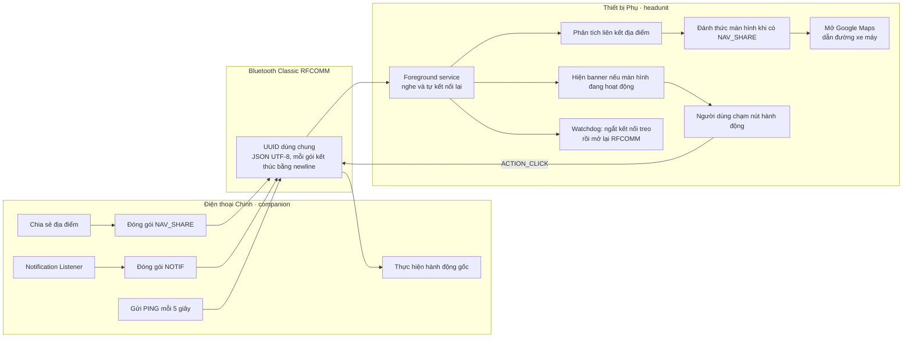

# MapsBridge

MapsBridge kết nối điện thoại **Chính** với thiết bị **Phụ** bằng Bluetooth Classic RFCOMM. Máy Chính có thể gửi địa điểm sang Google Maps trên Máy Phụ và chuyển tiếp thông báo cùng các thao tác gốc có sẵn.

## Ứng dụng làm gì?

- Chia sẻ một địa điểm từ menu Chia sẻ của Maps hoặc ứng dụng bản đồ; Máy Phụ phân tích liên kết và mở Google Maps ở chế độ dẫn đường xe máy (`mode=l`). Nếu màn hình đang ngủ, tuyến đường mới đánh thức màn hình để mở Maps.
- Chuyển tiếp thông báo từ ứng dụng người dùng, cùng tên ứng dụng, biểu tượng, tiêu đề, nội dung và tối đa ba nút hành động gốc.
- Hiển thị banner thông báo trên Máy Phụ khi màn hình đang hoạt động. Chạm nút trên banner sẽ gửi lệnh về Máy Chính để thực hiện hành động gốc.
- Duy trì kết nối RFCOMM bằng heartbeat và tự nghe lại khi mất kết nối. Dịch vụ Máy Phụ tự khởi chạy khi mở ứng dụng và sau khi thiết bị khởi động lại.
- Cung cấp launcher tùy chọn trên Máy Phụ với dock ứng dụng tùy chỉnh, ngăn ứng dụng, hình nền riêng, đồng hồ và lịch dương/âm.
- Cho phép màn hình launcher ngủ theo thời gian chờ. Dịch vụ giữ CPU hoạt động để duy trì Bluetooth; thông báo không đánh thức màn hình.

Thông báo hệ thống, thông báo đang chạy liên tục, thông báo Maps và thông báo nhóm bị lọc. Các nút yêu cầu nhập câu trả lời (`RemoteInput`) hiện không được chuyển tiếp; chỉ các thao tác gốc không cần nhập văn bản mới xuất hiện.

## Sơ đồ hoạt động



## Quy cách kết nối và gói tin

| Thuộc tính | Quy cách |
|---|---|
| Kết nối | Bluetooth Classic RFCOMM, điện thoại Chính kết nối tới thiết bị Phụ đã ghép đôi |
| UUID | `fa87c0d0-afac-11de-8a39-0800200c9a66` |
| Mã hóa/đóng khung | JSON UTF-8, mỗi gói nằm trên một dòng và kết thúc bằng `\n` |
| Heartbeat | Máy Chính gửi `PING` mỗi 5 giây; Máy Phụ ngắt socket nếu không nhận gói nào trong 12 giây và tự nghe lại |
| Chia sẻ đích | Máy Chính → Máy Phụ: `NAV_SHARE`, trường `payload` chứa nội dung chia sẻ hoặc URL bản đồ |
| Thông báo | Máy Chính → Máy Phụ: `NOTIF`, gồm `key`, `appName`, `icon` (PNG Base64), `title`, `text`, `actions[]` |
| Bấm nút thông báo | Máy Phụ → Máy Chính: `ACTION_CLICK`, gồm `key` và `actionIndex` |

Ví dụ gói tin:

```json
{"type":"NAV_SHARE","payload":"<nội dung chia sẻ địa điểm>"}
{"type":"NOTIF","key":"<notification-key>","appName":"<tên ứng dụng>","icon":"<PNG Base64>","title":"<tiêu đề>","text":"<nội dung>","actions":[{"index":0,"title":"Đánh dấu đã đọc"}]}
{"type":"PING"}
{"type":"ACTION_CLICK","key":"<notification-key>","actionIndex":0}
```

Máy Phụ dùng `google.navigation:q=…&mode=l` để yêu cầu Google Maps mở tuyến đường xe máy. Cả hai ứng dụng hoạt động trực tiếp qua RFCOMM, không cần Android Auto.

## Khả năng tương thích

| APK | Module | minSdk | Android tối thiểu | targetSdk | compileSdk | versionName | ABI |
|---|---|---:|---|---:|---:|---|---|
| MapsBridge Chính | `:companion` | 26 | Android 8.0 Oreo | 34 | 35 | `1.0` | Universal; không chứa thư viện native |
| MapsBridge Phụ | `:headunit` | 26 | Android 8.0 Oreo | 34 | 35 | `1.0` | Universal; không chứa thư viện native |

Do không đóng gói thư viện native, Android dùng runtime tương ứng với thiết bị; APK không bị giới hạn vào một ABI cụ thể. `targetSdk` là mức API ứng dụng khai báo mục tiêu; `compileSdk` là SDK dùng để biên dịch, không phải mức Android tối thiểu.

## Cài đặt nhanh

### Máy Chính

1. Tải và cài `MapsBridge-Chinh.apk`.
2. Bật Bluetooth, ghép đôi với Máy Phụ trong Cài đặt Android, rồi chọn thiết bị đó trong MapsBridge Chính.
3. Cấp quyền **Thiết bị ở gần** nếu Android yêu cầu.
4. Muốn chuyển tiếp thông báo, bật quyền **Quyền truy cập thông báo** cho MapsBridge.
5. Trong ứng dụng bản đồ, chọn **Chia sẻ** → **Dẫn đường trên Máy Phụ**.

### Máy Phụ

1. Tải và cài `MapsBridge-Phu.apk`, bật Bluetooth và ghép đôi với Máy Chính.
2. Mở ứng dụng và cấp quyền **Thiết bị ở gần**, **Thông báo** nếu được yêu cầu.
3. Cấp quyền **Hiển thị trên ứng dụng khác** để xem banner thông báo.
4. Có thể chọn MapsBridge làm **Màn hình chính**. Nhấn giữ biểu tượng dock để thay lối tắt; nhấn giữ viên trạng thái để mở tùy chọn launcher.

Giữ Bluetooth bật trên cả hai thiết bị. Banner chỉ hiện khi màn hình Máy Phụ đang hoạt động; thông báo không làm sáng màn hình.

## Tải APK và build

APK phát hành có tại [GitHub Releases](https://github.com/tuskudo2375/MapsBridge/releases). GitHub Actions cũng build APK debug trên các commit vào `main`; artifact có tên `MapsBridge-APKs`.

Build thủ công với JDK 17, Android SDK platform 35, build tools 35.0.0 và Gradle 8.7:

```sh
gradle :companion:assembleDebug :headunit:assembleDebug
```
